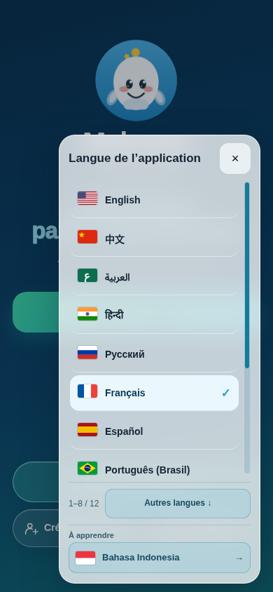
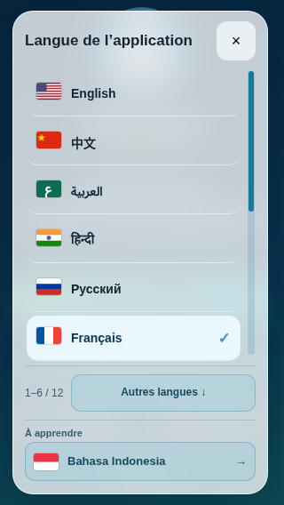
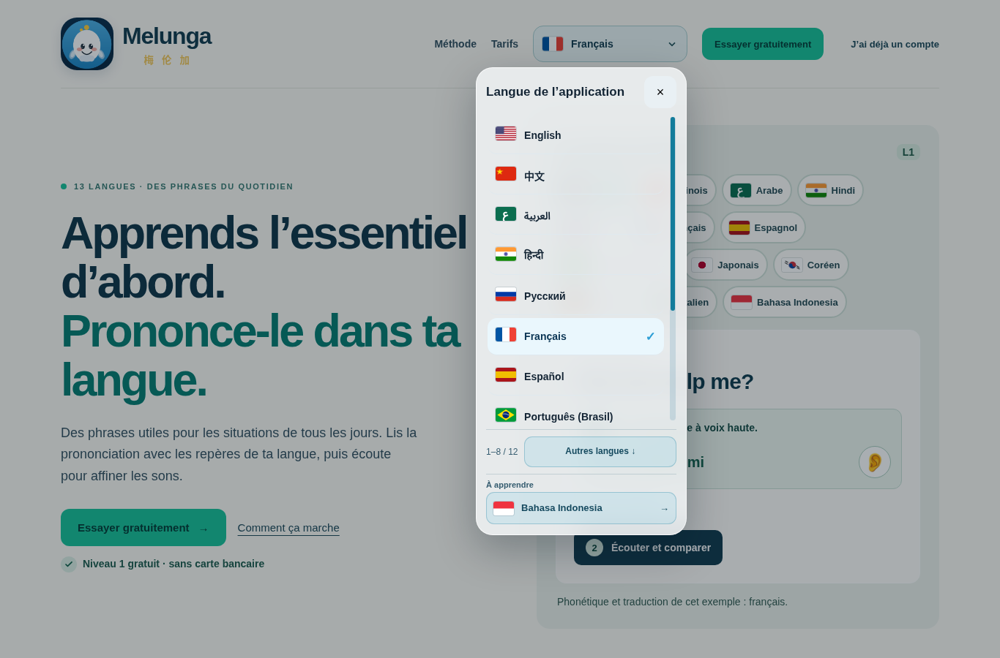
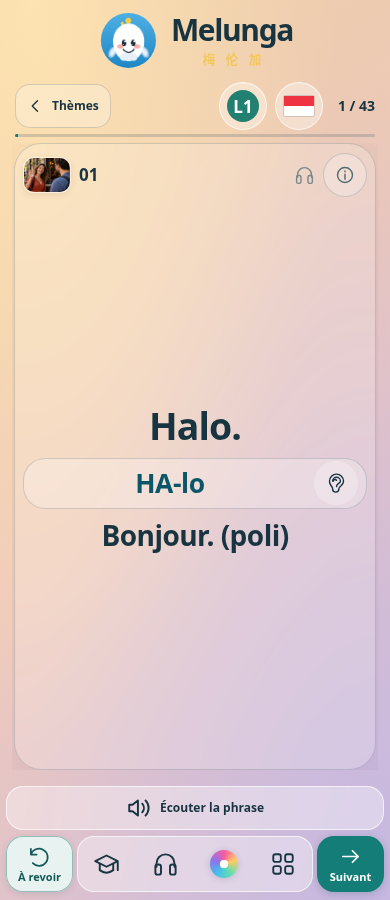

# Accueil : menu plus étroit, translucide et accès indonésien

Le sélecteur « Langue de l’application » conserve ses 12 interfaces existantes. Sa colonne passe à **288 px maximum**, avec un fond à **78 % d’opacité** et un flou de 18 px ; texte et drapeaux restent opaques. La règle mobile qui imposait toute la largeur est retirée. Le placement est ancré au bouton et limité au viewport ; hauteur maximale 640 px, réduite dans les petites fenêtres.

La barre de défilement colorée est permanente quand la liste déborde, avec curseur déplaçable, compteur de position et bouton « Autres langues » / retour en haut. Les commandes sont localisées dans les 12 langues. Clavier, touche Echap, fermeture au clic et retour du focus conservent le comportement du dialogue existant.

**Bahasa Indonesia apparaît dans une rubrique distincte « À apprendre », toujours visible en bas de ce menu pour les sept langues d’explication fournies.** Le clic réutilise la sélection existante de la langue à apprendre et ouvre le cours L1 sans changer la langue de l’interface. Il ne prétend pas proposer une interface indonésienne : le pack fourni contient le cours indonésien expliqué en français, anglais, espagnol, italien, chinois, japonais et coréen. Aucune traduction d’interface ou d’explication manquante n’est inventée. Le raccourci est masqué pour les cinq langues d’explication non fournies.

## Validation

- **48 combinaisons de menu** : 12 interfaces × 320×568, 390×844, 1024×600, 1366×900. Largeur ≤288 px, pas de sortie du viewport ni de débordement horizontal, fond à 78 %, textes et drapeaux visibles, liste complète accessible, curseur glissable, compteur, boutons, clavier et fermeture/Echap vérifiés.
- **14 parcours indonésiens** : 7 langues d’explication × mobile/ordinateur, depuis le menu de la première page jusqu’à la vraie carte L1. Drapeau SVG, direction et langue d’interface conservée vérifiés.
- Les **5 contrôles de source** passent ; dictionnaires de l’accueil reproductibles en `--check`. Syntaxe des scripts de la page vérifiée.
- `app.html`, les cartes, les événements et styles de capsule audio, les thèmes, le paiement et les modules de compte/progression ne changent pas. Seule la présentation d’accueil et son accès au sélecteur de cours sont modifiés.

Tests Chromium locaux avec médias/API simulés et émulation tactile. Aucun appareil physique, aucun compte ni paiement réel utilisés ; déploiement public non vérifié depuis cet environnement. Modification locale par Git, sans éditeur web GitHub.

