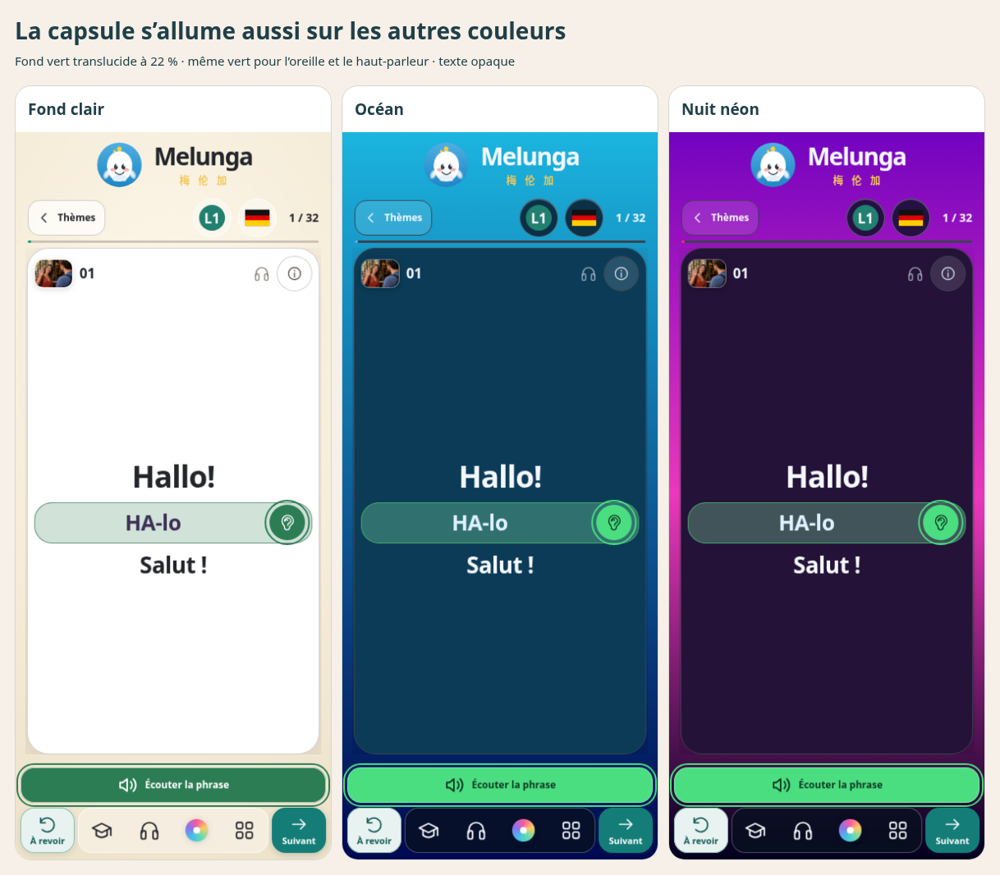
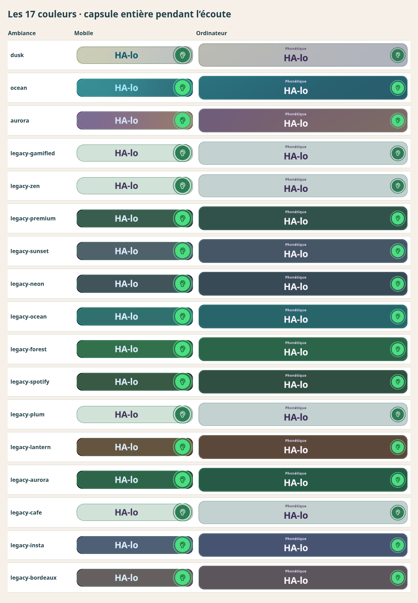

# Capsule entière — toutes les couleurs du parcours

Même principe que la capture de Kartech : capsule entière verte translucide, oreille et haut-parleur assortis pendant la lecture. Pas de défilement syllabique.

Le vert initial, adapté aux cartes claires, paraissait gris sur les cartes sombres. L’état de lecture utilise désormais un **vert plus lumineux sur les fonds sombres**, commun à l’oreille, au haut-parleur et à la capsule. Le vert des fonds clairs reste inchangé. L’oreille ne garde plus le rose, le bleu ou l’orange de l’ambiance pendant la lecture. Le texte du bouton reste contrasté (clair sur le vert foncé, sombre sur le vert lumineux).

- Fond à **22 %**, liseré fin de la même teinte à 55 %, texte phonétique opaque.
- Fondu de **150 ms**, sans pulsation ni décalage de mise en page ; préférence système de réduction des animations respectée.
- Déclenchement et arrêt inchangés : événements réels du lecteur partagé, haut-parleur/oreille, vitesse normale/lente, pause/reprise, fin, interruption et changement de carte.
- Les styles d’ambiance, les fonds de page/carte et les couleurs au repos sont conservés ; seuls les styles audio actifs changent. `course-ambiences.css`, `app.html`, les banques de cartes et les modules de compte/paiement/progression ne sont pas modifiés.

## Vérification complète

Le précédent contrôle du parcours couvrait ses trois premières ambiances ; le contrôle classique couvrait les 14 autres dans l’ancienne carte. Le nouveau test parcourt **les 17 couleurs du parcours**, lues directement dans la liste de l’application et changées par le vrai bouton de palette.

**442 combinaisons** = 13 langues étudiées × 17 couleurs × mobile 390 px / ordinateur 1366 px. **1 768 lectures contrôlées** (haut-parleur/oreille × normale/lente), avec couleur identique des deux boutons, capsule à 22 %, texte inchangé et géométrie identique. Le début différé pendant le chargement, les pauses/reprises et la fin restent contrôlés. Les captures de capsule couvrent chaque couleur et chaque format.

Les contrôles du fondu, du repli vers une voix navigateur, des fins périmées et du changement de carte passent aussi. La carte classique conserve ses 14 ambiances et 12 banques disponibles, dans les deux formats et avec les quatre déclencheurs. **33 tests audio et 5 contrôles de source réussissent.**

Tests Chromium avec médias et réseau simulés localement, émulation tactile ; aucun son réel ni appareil physique testé. Déploiement public non vérifié depuis cet environnement.

## Aperçus

La modification est réalisée localement par Git. `app.html` ne change pas ; aucun fichier volumineux n’est édité dans l’éditeur web GitHub.
