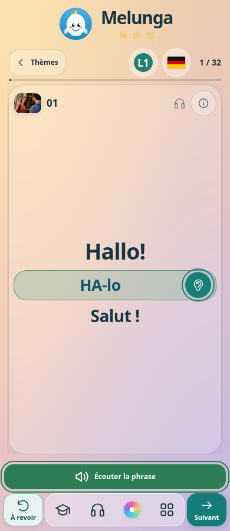
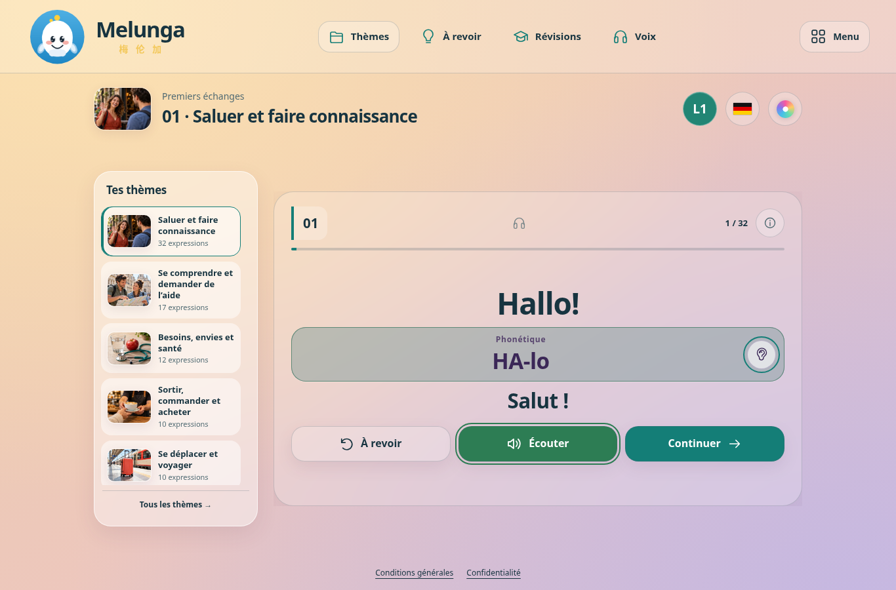

# Décision Kartech : seule la capsule entière est retenue

Aucun défilement syllabique. Les cinq variantes restent des propositions antérieures isolées, non importées dans les pages de l’application. Aucun code de ces maquettes n’est intégré par cette livraison. Les quatre maquettes du menu des langues n’appartiennent pas à cette modification.

La capsule entière conserve le fond translucide **22 %** et le liseré fin dans la couleur `var(--ok)` du haut-parleur en lecture ; les lettres restent opaques. Le fondu est de **150 ms**, sans pulsation, avec respect du réglage système de réduction des animations. Le calque ne modifie ni les dimensions ni la position du texte.

## Correction finale du déclenchement

Avant cette révision, le lecteur envoyait son signal de lecture dès la demande audio. Désormais, le haut-parleur et la capsule reçoivent ensemble le signal au début réel de la lecture (`audio.onplaying`, `utterance.onstart` / reprise). Le chargement seul et la résolution de la promesse `play()` n’allument rien. L’attente de données, la pause, l’arrêt, la fin, une interruption, une erreur sans repli et le changement de carte éteignent ensemble les contrôles. Le passage vers une voix du navigateur reste éteint tant que cette voix n’a pas commencé.

Il n’y a aucun minuteur visuel de durée. Le délai existant de détection d’un démarrage bloqué n’a pas été changé ; il est supprimé dès le début du son et ne coupe pas une lecture longue.

## Résultats

- **33 tests audio unitaires réussis**, dont chargement, début réel, attente/reprise, lecture longue sans arrêt artificiel, interruption et événements périmés, dans les 13 langues et les deux vitesses.
- **78 combinaisons parcours** : 13 langues étudiées (les 12 demandées plus l’indonésien), 3 ambiances, 2 largeurs (390 et 1366 px) ; **312 lectures** haut-parleur/oreille × normale/lente. Signal commun, absence d’allumage au chargement, fond à 22 %, lettres opaques et géométrie inchangée vérifiés.
- **336 combinaisons carte classique** : 14 ambiances immersives réellement énumérées × 12 banques classiques disponibles × 2 largeurs, chaque fois avec haut-parleur, oreille et commandes normale/lente. L’allemand est couvert dans le parcours. Fin et changement de carte vérifiés.
- Fondu de 150 ms, voix du navigateur de repli et anciens événements après navigation vérifiés dans les deux formats ; captures actives/repos jointes.
- **5 contrôles de source réussis** : banques, thèmes, compte, droits et fonctions de progression protégés par leurs empreintes.

Le changement du produit concerne trois lignes de signalisation dans le lecteur partagé et son commentaire, ainsi que la version de cache dans les quatre pages qui le chargent. CSS, thèmes, architecture, comptes, paiement, progression et cartes inchangés. `app.html` ne change que de numéro de version du lecteur, sans augmentation du nombre d’octets. Modifications locales par Git, sans éditeur web GitHub.

Tests Chromium avec médias et réseau simulés localement, émulation tactile. Aucun son réel ni appareil physique testé ; déploiement public non vérifié depuis cet environnement.

