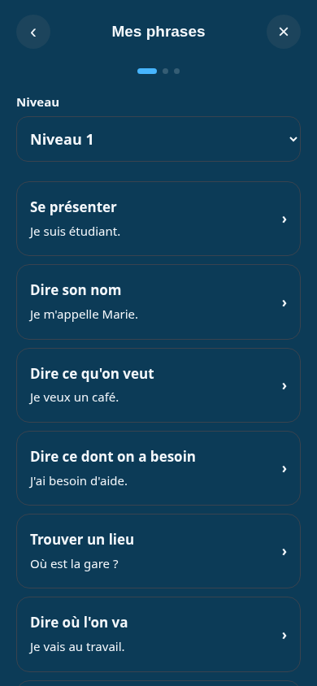
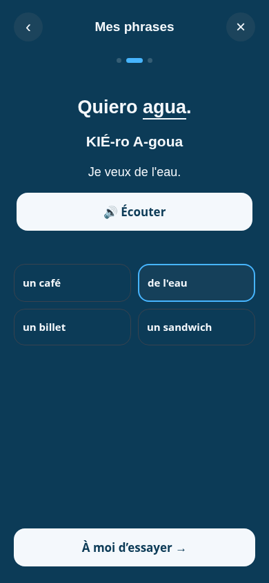
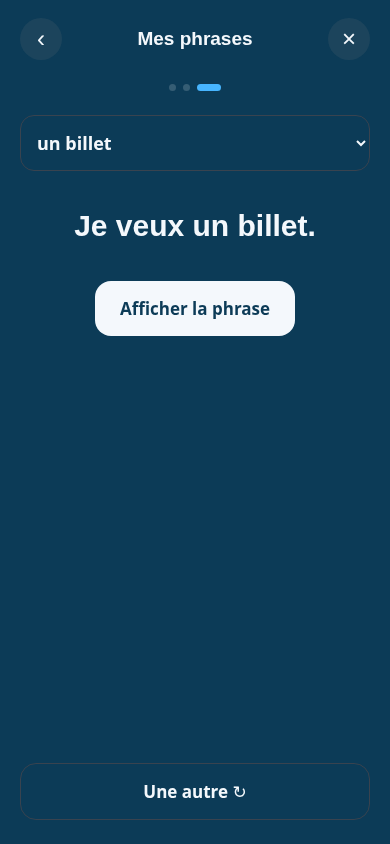
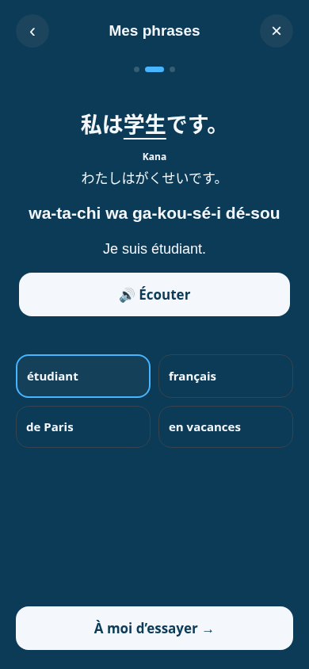

# Lot B — « Mes phrases » sur les contenus chargés

Branche `feat/conversation-integration`, PR #7. Lot A relu au commit `f59ae9a` : son contrat permet le branchement UI ; tests simulés du chargeur réussis. Aucune fusion ou publication.

## Parcours livré

1. Choix compact du niveau (1–10), puis liste des situations avec exemple traduit.
2. Phrase complète, complément souligné, lecture propre à la langue si présente, phonétique, traduction et écoute ; choix des variantes.
3. Choix d'une phrase traduite, réponse étudiée et aides cachées, puis révélation et écoute. « Une autre » masque à nouveau la réponse.

Sept couples disponibles : fr→es/en/zh/it/ja/ko et zh→fr. Les phrases viennent directement des variantes complètes ; aucun assemblage par gabarit. Les contenus et le chargeur du lot A n'ont pas été modifiés.

- Chargement visible ; panne réseau ou fichier invalide → message et bouton de nouvelle tentative.
- L1 absent (404) → fermeture et pastille masquée pour ce couple durant la session. Un niveau supérieur absent laisse le sélecteur accessible pour revenir à un autre niveau.
- Les réponses anciennes sont ignorées après fermeture, changement de niveau ou changement du couple de langues, y compris vers un couple indisponible.
- Audio : `speak(variant.study, bouton)` ; jamais la phonétique ni le pinyin.
- Échap, retour, focus et isolation des gestes tactiles conservés.
- L'ancien parcours reste accessible si le chargeur n'est pas présent ou si la constante locale `USE_CONVERSATION_FILES` est désactivée. Une panne du chargeur ne provoque pas de bascule silencieuse.

## Droits d'accès

Tous les niveaux sont consultables sur un hôte Netlify `deploy-preview-*` ou un serveur local de développement hors application native. Sur le site public et dans Capacitor : L1 accessible, niveaux supérieurs désactivés sans le statut `isPaid` existant. Aucun statut Premium n'est écrit par ce module. Ceci conserve le contrôle UI existant ; les fichiers JSON statiques ne constituent pas un service d'autorisation serveur.

## Contrat proposé à Claude pour le lot D

Le module lit les libellés à chaque rendu dans :

```js
window.ConversationLabels = {
  fr: { level: 'Niveau', /* ... */ },
  zh: { level: '级别', /* ... */ }
};
```

Clés nouvelles : `level`, `model`, `loading`, `error`, `retry`, `missing`, `try`, `reveal`, `another`, `phrase`, `back`, `close`, `step`, `of`, `premium`, `reading`, `pinyin`, `kana`, `romanization`.

Les libellés existants `UI[nat]` fournissent encore le titre, la pastille et « Écouter ». Des valeurs françaises/chinoises de secours permettent les sept couples actuels. Le lot D peut livrer son script séparé et son chargement sans modifier `construire.js`. Le choix des niveaux ne traduit pas automatiquement les titres de situations livrés par les fichiers de contenu.

## Vérification

- `node --check melunga_deploy/construire.js`
- `node melunga_deploy/tests/conversation-loader.test.cjs`
- `NODE_PATH=/tmp/melunga-review-tools/node_modules node melunga_deploy/tests/conversation-ui.test.cjs`

Le test UI nécessite `playwright-core` et Chromium (`CHROMIUM_PATH`, défaut `/usr/bin/chromium`). Il démarre son propre serveur HTTP local et simule les réponses réseau avec les vrais fichiers JSON du dépôt.

Vérifications : sept couples ; variantes et lectures exactes ; réponse masquée ; argument audio ; retour du focus ; gestes sans classement de la carte derrière ; L10 en 320×568 et 1440×900 ; panne, fichier invalide et reprise ; réponse espagnole tardive après passage au japonais ; couple indisponible ; fichier absent ; niveaux Premium désactivés sur origine publique puis accessibles avec le statut payé.

Limites : essais réseau et statut payé simulés, pas d'écoute distante ni de test APK réel. Les essais CORS/Capacitor du lot A restent nécessaires avant une publication native. Dialogues (C), traductions complètes (D), reprise persistante (E) et statut éditorial visible (F) ne sont pas livrés ici. Ouverture sur L1 à chaque session pour l'instant.

## Captures mobile (390×844)








