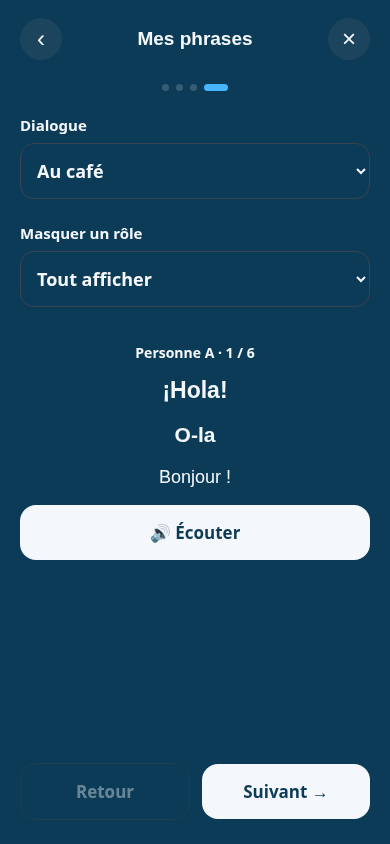
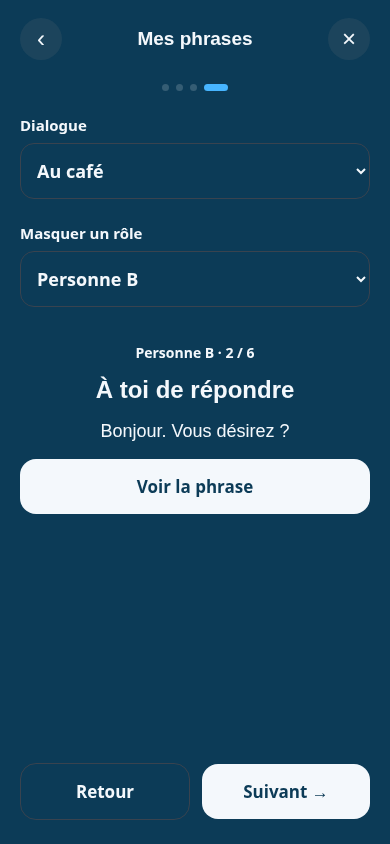

# Lot C — Converser

Sur `feat/conversation-integration` (PR #7), après le lot D `de9410a`. Aucun changement du chargeur, des contenus, de `app.html` ou des traductions externes. Ni fusion ni déploiement.

## Parcours

- « Converser » est accessible depuis le choix des situations et depuis l'exercice de rappel.
- Choix parmi les dialogues du niveau courant, puis une réplique affichée à la fois.
- Rôle B masqué par défaut ; choix du rôle A, du rôle B ou de « Tout afficher ».
- Pour une réplique masquée : traduction comme indice, phrase étudiée, phonétique, lecture et écoute absentes du rendu. Le bouton « Voir la phrase » révèle la réponse et permet ensuite l'écoute.
- Répliques visibles : texte étudié complet, lecture (pinyin/hiragana/romanisation) si présente, phonétique, traduction et bouton d'écoute.
- `speak(turn.study, bouton)` reçoit toujours la phrase complète dans la langue étudiée ; aucun assemblage ni synthèse de la phonétique.
- Retour et suivant passent d'une réplique à l'autre. Chaque changement de réplique, de dialogue ou de rôle masque à nouveau les réponses concernées. « Terminé » et le retour d'en-tête ramènent à l'étape d'où l'utilisateur est entré.
- Quatre étapes dans l'indicateur. Aucun score, déblocage ou évaluation automatique ; `reuses` n'est pas exploité.

Les phrases sont affichées avec `textContent` et les attributs de langue correspondants. Le panneau conserve l'isolation tactile et clavier ainsi que le retour du focus à la fermeture.

## Libellés du lot D utilisés

`stepConverse`, `dialogue`, `hideRole`, `showAll`, `roleA`, `roleB`, `yourTurn`, `listen`, `reveal`, `back`, `next`, `done`, plus les libellés de lecture du lot B. Aucun texte de dialogue n'est retraduit dans le module.

## Vérifications

```sh
node --check melunga_deploy/construire.js
node melunga_deploy/tests/conversation-loader.test.cjs
NODE_PATH=/tmp/melunga-review-tools/node_modules node melunga_deploy/tests/conversation-ui.test.cjs
```

Le test UI requiert `playwright-core` et Chromium (`CHROMIUM_PATH`, défaut `/usr/bin/chromium`) ; le serveur HTTP est démarré par le test. Il utilise les vrais contenus JSON avec transport réseau simulé.

- Sept couples, trois dialogues L1 par couple : texte exact de chaque réplique, lectures présentes, changement du dialogue.
- Rôles A et B masqués, réponse sans fuite textuelle/phonétique/lecture/écoute avant révélation ; choix « Tout afficher ».
- Écoute : argument transmis au moteur identique à la réplique.
- Navigation précédent/suivant, fin du dialogue, retour d'en-tête, fermeture et retour du focus.
- Glissement dans le dialogue sans modifier la position ni les cartes connues de la leçon derrière.
- Parcours L10 et dialogue complet à 320×568 et 1440×900, sans débordement horizontal.
- Tests du lot B conservés : pannes/reprise, changement rapide de langue, accès gratuit/Premium simulé.

Limites : pas d'écoute du service distant ni d'essai APK physique. Le lot F (statut éditorial visible) et le lot E (reprise persistante) restent séparés.

## Captures — 390×844





## Passage de relais à Claude

Le fichier `construire.js` est disponible pour F après le commit du lot C. Points d'insertion : `renderConversation()` construit la feuille puis appelle `renderDialogue(sheet)` pour l'étape 4 ; le contenu courant est dans `conversation.data`. Prévoir la mention aussi dans ce parcours. Les libellés `reviewNotice` et `phonHint` sont déjà fournis par le lot D.

## Rôles nommés — après réception de l’APK v3

Le rendu lit désormais `roles.A` / `roles.B` (dans la langue maternelle du fichier). `learnerRole` détermine le rôle masqué à l’entrée et lors du changement de dialogue. Les fichiers antérieurs gardent les libellés Personne A/B et le rôle B masqué. Les tests parcourent les sept couples, vérifient les noms et le rôle initial ; les phrases complètes restent inchangées. L’APK v3 reçu ne contient pas encore ce raccordement UI.
