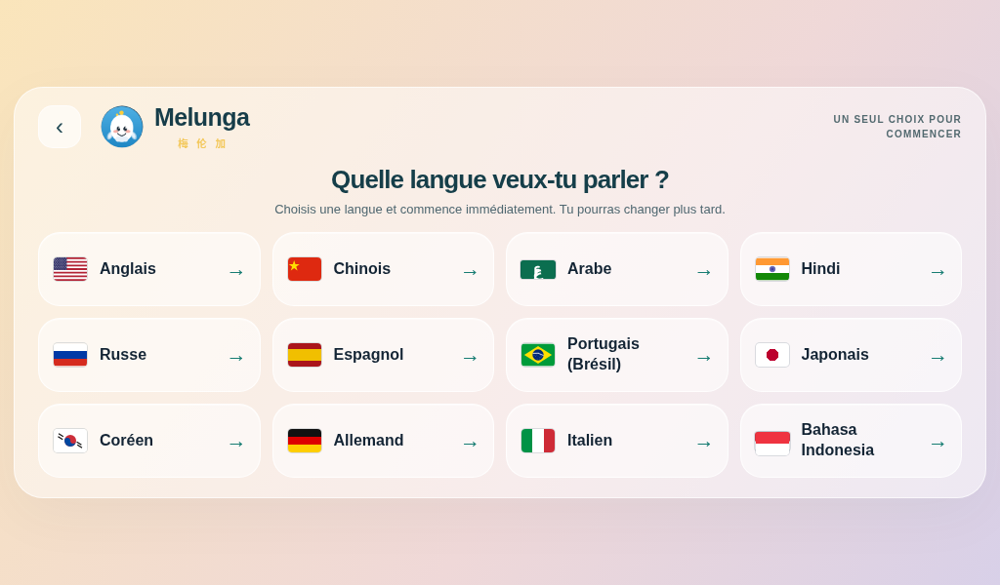
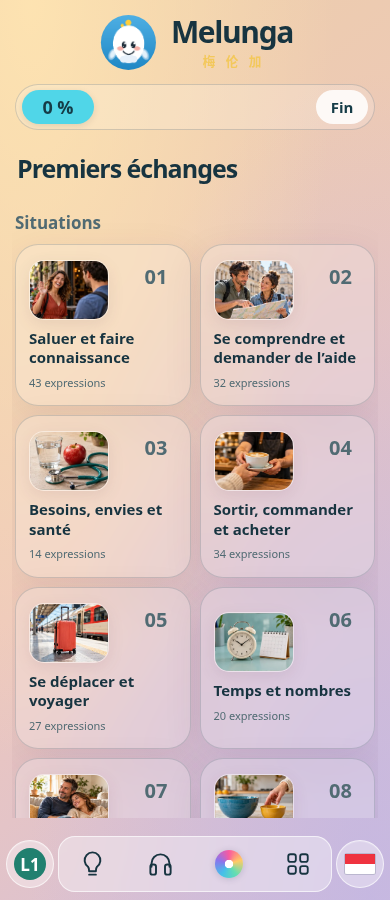
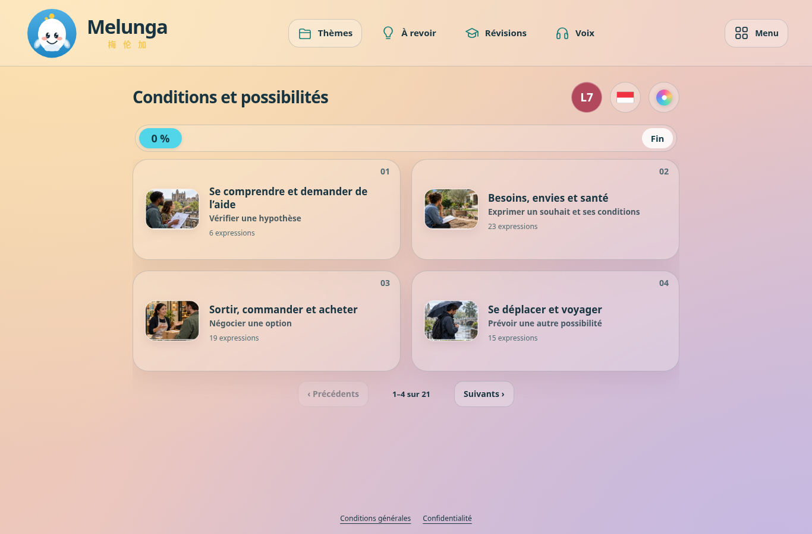

# Bahasa Indonesia — intégration et revue

4 487 cartes reçues, **4 410 actives et 77 modèles en réserve**, L1–L10. Bouton **Bahasa Indonesia**, drapeau SVG rouge/blanc, audio et reconnaissance **id-ID**, choix féminin/masculin du lecteur partagé, comparaison des réponses avec ponctuation et redoublement (`laki-laki`, `laki laki`, `laki2`, ainsi que les suffixes). La capsule phonétique audio reste disponible pour cette nouvelle langue.

Le pack fournit sept langues d’explication : français, anglais, espagnol, italien, chinois, japonais et coréen. Ces **7 nouvelles directions** sont intégrées, soit 135 directions au total. Il ne fournit pas les traductions indonésiennes pour une interface allemande, russe, portugaise, arabe ou hindi : aucune de ces cinq directions n’est inventée, et l’indonésien n’est pas ajouté comme langue de l’interface.

## Classement et contrôle du contenu

Chaque carte active a une affectation explicite par domaine et indice source, indépendamment des traductions équivalentes d’autres banques. Référence allemande pour les noms et illustrations de domaine uniquement. Les rubriques concrètes restent prioritaires à tous les niveaux ; les compétences L7–L10 apparaissent en sous-titres. [Tableau des domaines](DOMAINES.md).

**500 cartes vérifiées par sondage, 50 par niveau**, selon le naturel, le registre, les e et l’accent des guides, ainsi que les traductions japonaise et coréenne. Revue effectuée par Codex, sans relecteur humain natif, conformément à la demande. Elle ne constitue pas une garantie exhaustive de naturel. Les 4 410 phrases ont aussi été lues pour leur domaine.

**40 cartes / 191 champs corrigés**, avec [numéro, champ et correction](CORRECTIONS.md). Les écarts comprennent notamment Silakan, semester, des annotations masculines sans fondement, des sens trop partiels et neuf entrées de translittération apartemen/stres. Les cinq phonétiques corrigées sont régénérées par les scripts fournis. Les 22 435 sorties phonétiques du deck canonique sont reproduites exactement. Les fichiers reçus, le journal des modifications et les indices des 500 cartes sont conservés dans [les sources de l’import](../../tools/maquette-guidee/imports/indonesian-v1).

| Niveau | Cartes reçues | Actives | Réserve | Sondage |
|---|---:|---:|---:|---:|
| L1 | 283 | 270 | 13 | 50 |
| L2 | 545 | 532 | 13 | 50 |
| L3 | 633 | 622 | 11 | 50 |
| L4 | 594 | 589 | 5 | 50 |
| L5 | 683 | 674 | 9 | 50 |
| L6 | 439 | 429 | 10 | 50 |
| L7 | 430 | 424 | 6 | 50 |
| L8 | 402 | 399 | 3 | 50 |
| L9 | 227 | 224 | 3 | 50 |
| L10 | 251 | 247 | 4 | 50 |

## Vérifications

- 34 contrôles de données/source : les 12 anciennes banques et leurs classements restent exacts, 77 modèles exclus, 70 nouvelles combinaisons langue/niveau ; les 1 350 combinaisons de la totalité du catalogue conservent les objets carte/activité et droits attendus. Les fonctions de compte et de progression sont protégées par leurs empreintes.
- 78 tests audio, choix de voix, TTS et import : deux voix indonésiennes, contrôle de la liste fournisseur, repli uniquement vers une voix navigateur compatible, absence de substitution française, lecture normale/lente.
- 6 groupes navigateur : choix des langues sur une page ordinateur jusqu’à 1024×600 ; sept langues d’explication sur mobile/ordinateur ; dix niveaux, images et sous-titres ; choix de voix, révisions, progression/rechargement ; retour compte existant L2 ; reconnaissance web et pont natif `id-ID`.
- Capsule : **78 combinaisons parcours** (13 langues × 3 ambiances × 2 formats), 312 lectures. Carte classique : 14 ambiances × 12 banques × 2 formats, haut-parleur/oreille et vitesses normale/lente ; toutes les ambiances sont réellement énumérées par le contrôle existant. Géométrie visible, pauses/reprises, fin, interruption et changement de carte vérifiés.
- Export et dictionnaires reproductibles en mode `--check` ; syntaxe des 13 scripts HTML et de neuf fichiers JS/services vérifiée.

Tests locaux Chromium et fixtures média/API, émulation tactile. Aucune synthèse réelle, aucun appel au fournisseur, aucun appareil physique ni vrai compte/paiement manipulé. Les noms des deux candidates WaveNet sont revérifiés contre `voices:list` au moment du service ; leur disponibilité en production n’a pas été confirmée depuis cet environnement. Sans voix compatible, le comportement existant d’indisponibilité/repli s’applique. La clé TTS reste uniquement dans l’environnement serveur.

Les 5 maquettes syllabiques et 4 menus de langues restent des propositions autonomes : aucun de leurs mécanismes n’est intégré dans les cartes ou le menu. Les aperçus des menus illustrent les 11 cibles de leur base avant l’indonésien.

`app.html` : 21,846,165 → 23,925,795 octets, soit +2,079,630 pour cet import, formatés ici en octets. Fichier déjà supérieur à 3,6 Mo : modification locale par Git, sans éditeur web GitHub. Déploiement public et son réel non vérifiés.

