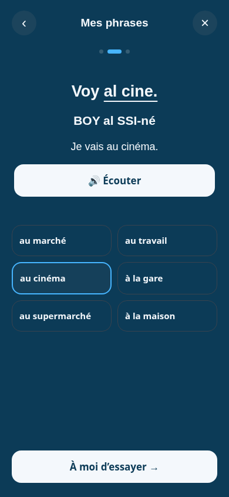
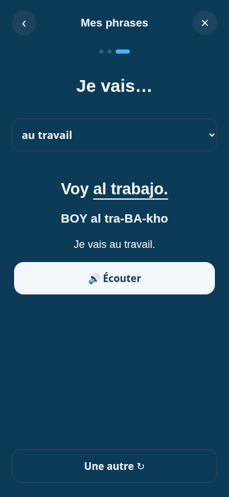

# PR #5 — Mes phrases du quotidien

Parcours proposé pour les francophones apprenant l’espagnol : une phrase utile, le remplacement d’un morceau, puis un essai personnel avant de révéler la réponse. Six familles et 36 exemples au présent. Aucun pourcentage de couverture de la langue n’est revendiqué.

1. Choisir une phrase du quotidien.
2. Toucher un complément pour transformer la phrase et l’écouter.
3. Choisir un nouveau complément, essayer de dire la phrase, puis révéler l’espagnol et sa phonétique.

Les données `CONSTRUIRE.es`, les libellés `UI`, la fonction `build()` et la pastille d’entrée restent inchangés. Les destinations sont un nouveau jeu de compléments séparé. L’audio appelle toujours `speak(text, btn)`. Aucun changement de `app.html` dans cette livraison.

Les gestes du panneau sont isolés de la leçon derrière. Fermeture avec Échap, retour du focus et navigation clavier dans le dialogue ajoutés.

## Captures mobile — 390 × 844

### 1. Choisir

### 2. Remplacer

### 3. Créer

## Vérifications

- `node --check melunga_deploy/construire.js` : réussi.
- Chromium : 390 × 844, 320 × 568, 1440 × 900 ; aucune erreur JavaScript sur `app.html?start=1&lang=fr&study=es`.
- 36 choix exercés à chaque taille ; absence de débordement horizontal.
- Rappel avec réponse masquée, révélation, intégration audio (appel simulé), fermeture Échap et retour du focus vérifiés.
- Un glissement dans le panneau ne modifie ni la position ni les cartes connues de la leçon.
- Vérification d’identité du bloc original contenant `CONSTRUIRE`, `UI` et `build()`.

Limites : parcours éditorial en français ; ne constitue pas une nouvelle traduction des sept langues. Aucun APK/AAB construit et aucune écoute réelle de service audio distant dans ces tests. Branche à revoir avant fusion.
