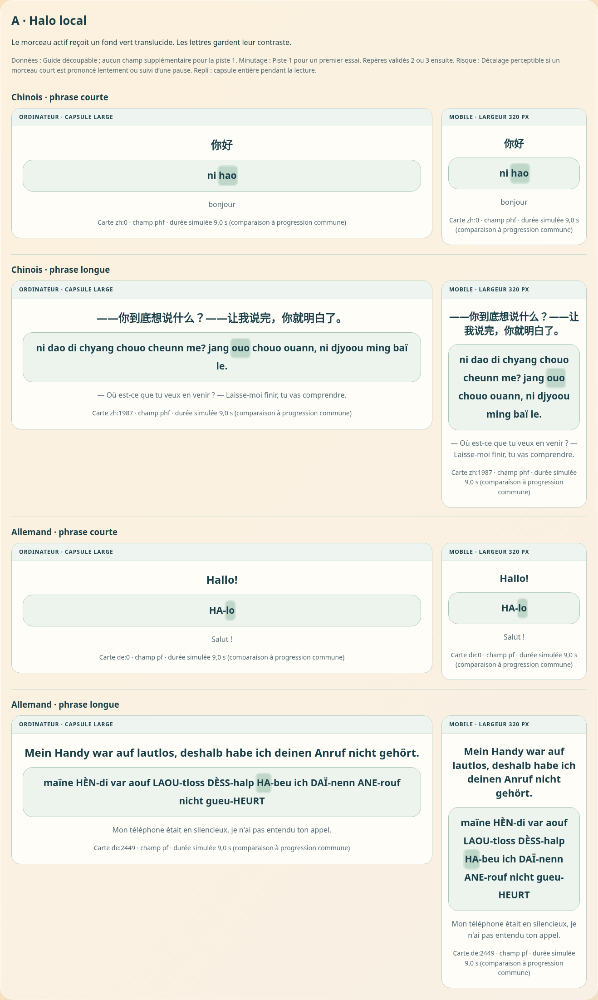
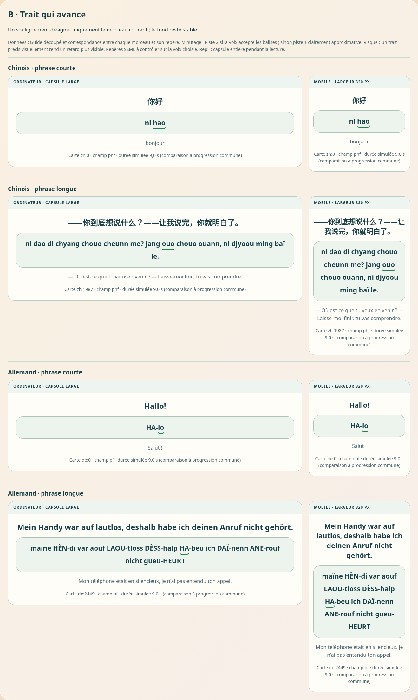
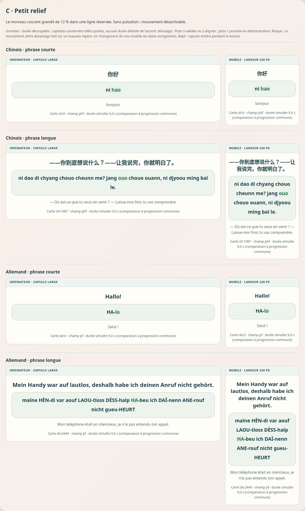
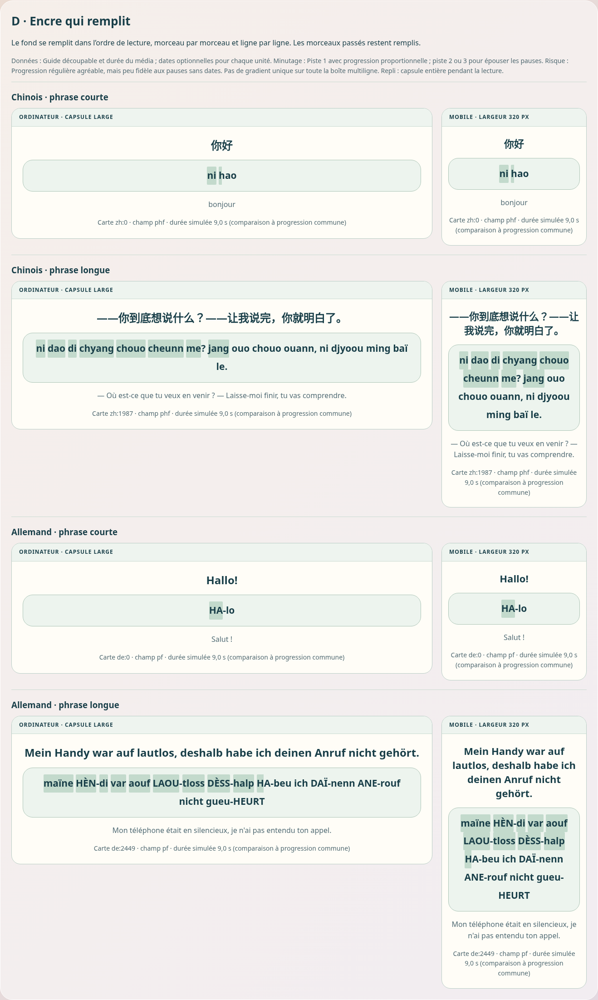
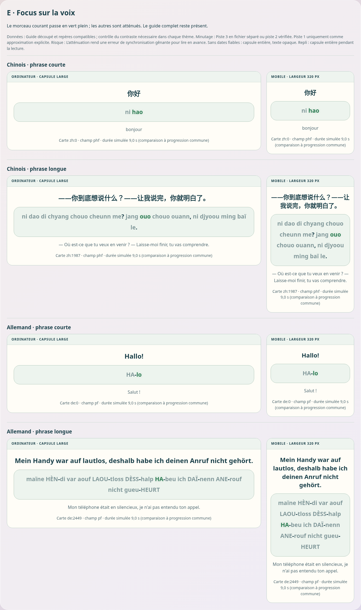

# Cinq maquettes syllabiques — sans intégration

Ouvrir [la page HTML autonome](../../melunga_deploy/propositions-capsule-syllabes.html) après téléchargement, ou via le site s’il a été déployé. Aucun appel réseau, aucune clé et aucun branchement à l’application. Simulation visuelle sans son. **0 octet ajouté à app.html par cette proposition** ; HTML autonome d’environ 15 Ko.

Chaque variante montre chinois/allemand × court/long × mobile/ordinateur : 40 aperçus. Les contrôles permettent lecture simulée, pause, vitesse, déplacement du curseur et absence de repères. Pause et fin éteignent l’éclairage ; l’absence de dates utilise la capsule entière. Les guides restent textuellement identiques à la source. Le minutage simulé de 9 secondes, commun aux exemples pour comparer les styles, ne prétend pas suivre un enregistrement.

- **A : halo translucide** du morceau actif ; guide découpable, pondération de la durée (piste 1), approximation sensible aux pauses. Meilleur premier essai si une synchronisation approximative est acceptée.
- **B : soulignement** ; guide aligné et dates SSML compatibles (piste 2), à vérifier sur la voix. Un retard est visuellement net.
- **C : léger grossissement** par transformation sans recalcul de la ligne ; repères vérifiés (pistes 2/3), mouvement désactivé en préférence de réduction des animations. Une mauvaise date attire fortement l’œil.
- **D : remplissage cumulatif** dans l’ordre des morceaux et des lignes ; durée seule possible (piste 1), pauses approximatives. Pas de gradient simultané sur toutes les lignes.
- **E : couleur active, autres morceaux atténués** ; repères vérifiés séparés (piste 3/2), contraste à confirmer selon le thème avant intégration. Mauvais repères plus gênants pour lire en avance.

Pour les cinq, données insuffisantes/incompatibles ⇒ retour à la capsule entière de la livraison 1, texte opaque. Une absence de séparateurs n’est pas compensée par une découpe inventée des lettres.

## Données réellement disponibles

Audit sur les sources actives affichables, pour un francophone sauf français étudié depuis le chinois. Comptes des caractères présents, pas validation linguistique des syllabes ; réserves exclues. Les tirets et espaces peuvent coexister. Le champ de repli `py` est pris exactement comme le fait le parcours.

| Direction | Champ demandé | Cartes actives | Tiret | Espace | Vide | Repli py |
|---|---|---:|---:|---:|---:|---:|
| zh-fr | phon | 4335 | 5 | 3254 | 0 | 0 |
| fr-en | pf | 4336 | 2798 | 3921 | 0 | 0 |
| fr-es | pf | 3616 | 3575 | 3467 | 0 | 0 |
| fr-it | pf | 3704 | 3656 | 3294 | 0 | 0 |
| fr-zh | phf | 4807 | 1118 | 4359 | 0 | 0 |
| fr-ja | pf | 3665 | 3644 | 2367 | 0 | 0 |
| fr-ko | pf | 3697 | 3605 | 2450 | 0 | 0 |
| fr-de | pf | 4444 | 3995 | 4084 | 0 | 0 |
| fr-hi | pf | 4410 | 4142 | 3249 | 0 | 0 |
| fr-ru | pf | 4411 | 4255 | 3027 | 0 | 0 |
| fr-pt | pf | 4410 | 4352 | 3983 | 0 | 0 |
| fr-ar | pf | 4410 | 4402 | 3392 | 0 | 0 |

Le guide peut donc être segmenté dans de nombreuses cartes, mais les séparateurs ne sont pas universels. Les champs varient avec la langue d’explication (`pf`, `phf`, `py`, `phon`, etc.) ; japonais/coréen peuvent utiliser le guide anglais de repli. Les capitales peuvent marquer un accent, pas une durée. Les quatre scénarios reprennent les cartes `zh:0`, `zh:1987`, `de:0`, `de:2449`, sans réécriture.

## Minutage et poids

1. Répartir `audio.duration` par nombre de lettres de chaque morceau, suivre `audio.currentTime`. Petit code, aucune date ajoutée aux cartes, synchronisation approximative. Durée infinie/inconnue ⇒ capsule entière.
2. Modifier le service pour obtenir des timepoints de balises SSML, après vérification des capacités de la voix choisie. L’API actuelle reçoit du texte et renvoie un MP3 sans ces métadonnées. Un timepoint date une balise ; ce n’est pas une découverte automatique de frontière syllabique. Les balises à l’intérieur des mots peuvent changer la voix. Alignement guide/texte et validation acoustique nécessaires. Coût technique et facturation à examiner selon l’offre ; pas de promesse de précision automatique.
3. Dates vérifiées dans un fichier séparé chargé à la demande, indexé par empreinte du texte et du guide, version de segmentation, voix, moteur, locale et vitesse de synthèse. Invalider au changement. Ne pas remplir les catalogues de dates : 200–400 octets par carte représenteraient environ 11–22 Mo pour 54 583 cartes et une configuration, estimation indicative.

La vitesse client suit le temps du média, sans multiplier deux fois la vitesse ; une nouvelle synthèse serveur nécessite ses propres dates. Le repli vers une voix navigateur sans dates utilise la capsule entière. La clé reste uniquement dans `process.env.GOOGLE_TTS_API_KEY`, côté serveur.

Future réalisation externe : ordre de grandeur 5–12 Ko JS/CSS hors dates, à mesurer après choix. app.html est déjà au-dessus de 3,6 Mo ; toutes les modifications sont faites localement par Git, sans l’éditeur web GitHub.

## Vérification des maquettes

Chromium local, largeurs 390 et 1366 px ; cinq variantes, 40 aperçus par largeur, absence de débordement horizontal, géométrie stable, commandes et repli contrôlés. Aucune voix réelle, aucun fournisseur ni appareil physique testé. Déploiement public non vérifié.

