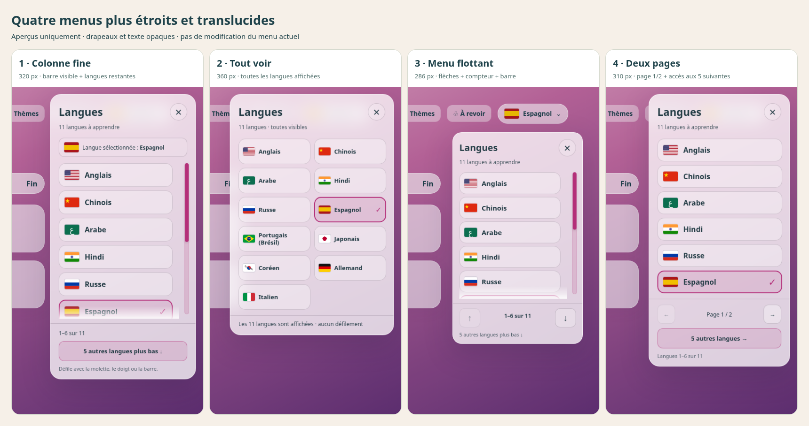
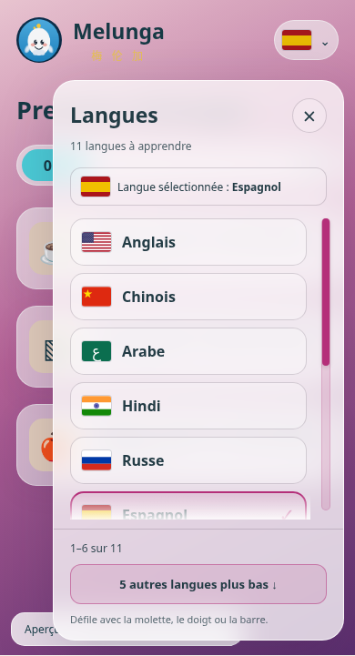
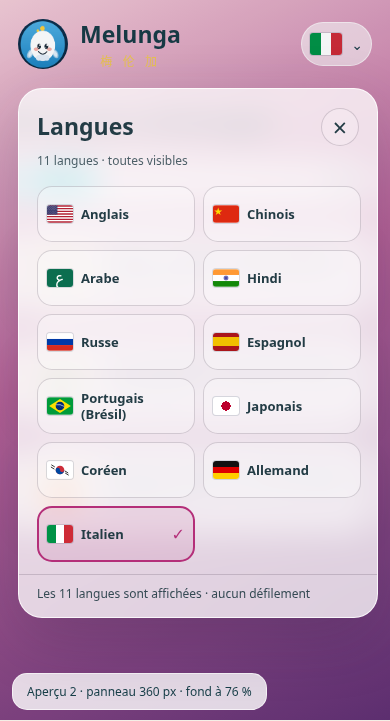
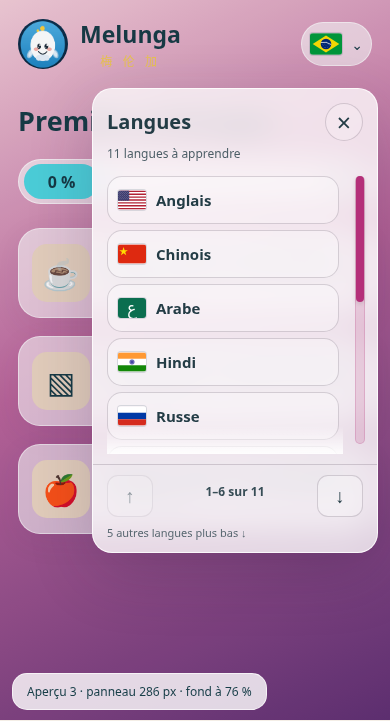
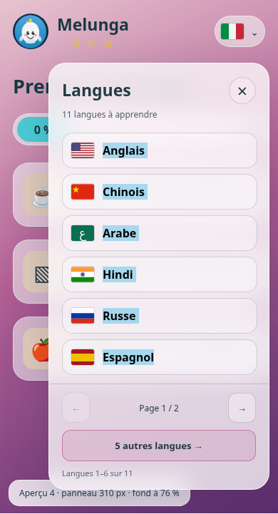

# Quatre menus de langues plus étroits et translucides

**Maquettes uniquement : le menu de l’application reste inchangé.**

- **1 — Colonne fine : 320 px.** Liste verticale compacte ; curseur coloré permanent, manipulable, synchronisé au défilement réel ; compteur de position et nombre de langues restantes. Ligne suivante partiellement visible et bouton pour descendre/remonter.
- **2 — Tout voir : 360 px.** Deux colonnes, les 11 langues de cet exemple affichées ensemble. Pas de coulisseur nécessaire ; compteur explicite de toutes les langues visibles.
- **3 — Menu flottant : 286 px.** Ancré sous le drapeau, hors du parcours principal ; curseur visible, boutons haut/bas et compteur. Le plus étroit.
- **4 — Deux pages : 310 px.** Six langues puis cinq, boutons précédent/suivant, « Page 1 / 2 » et « 5 autres langues ». Aucune suite cachée par un défilement discret.

Fond du panneau à 76 % par défaut, réglable de 55 à 88 %. Flou de fond de 16 px ; texte et drapeaux à 100 % d’opacité. Démonstration sur trois ambiances indépendantes (rose, océan, sable), sans modification des thèmes de production. Largeurs adaptées au mobile. Ordre demandé conservé pour les langues disponibles : anglais, chinois, arabe, hindi, russe, espagnol, portugais (Brésil), japonais, coréen, puis allemand et italien. Exemple d’interface française : français absent des cibles, donc 11 choix de la version publiée. L’indonésien reste dans son travail d’intégration séparé.

Je recommande **1** pour garder une grande lisibilité ou **2** pour tout voir immédiatement.

[HTML autonome à télécharger et ouvrir](../../melunga_deploy/propositions-selecteur-langues.html). Une fois déployé, son adresse est `/propositions-selecteur-langues.html` ; déploiement public non vérifié depuis cet environnement. Aucun appel réseau dans la page et aucune sauvegarde de progression : sélection simulée seulement.

Vérifications Chromium local : **48 combinaisons** (4 variantes × 3 fonds × largeurs 320, 390, 1024 et 1366), aucune sortie horizontale, panneau translucide et texte opaque, liste complète des variantes 2/4 au-dessus du pied, curseur glissable réel, boutons de défilement, dernier choix accessible, pagination, sélection et fermeture/réouverture/Echap. Les 5 contrôles de source passent ; app.html, comptes, progression et thèmes inchangés par ces maquettes. Pas de test sur appareil physique.

## Mobile

