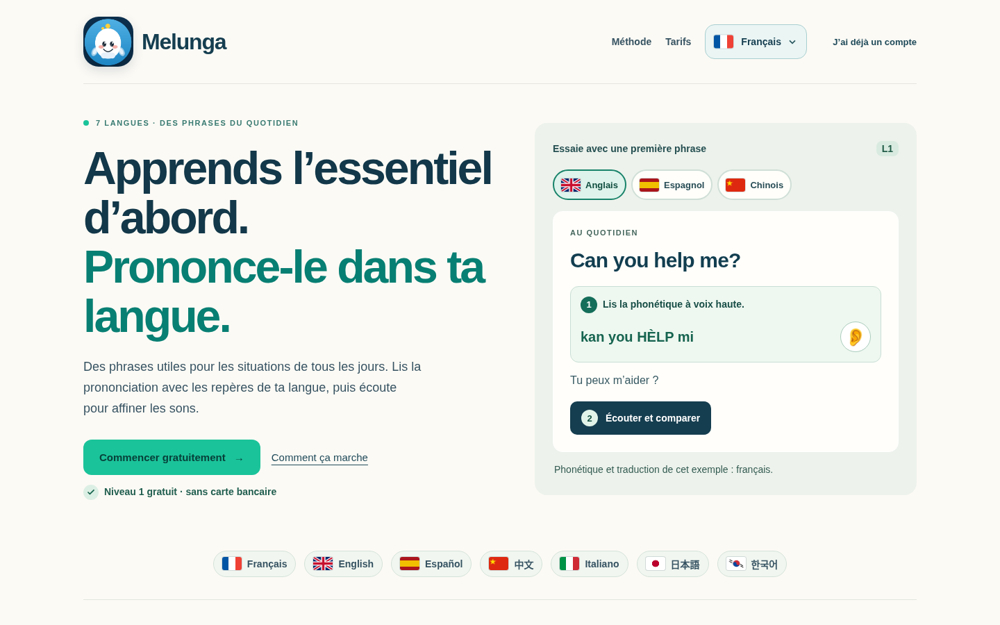

# Accueil Melunga — langues, lisibilité et premier essai

Proposition validée par Kartech le 21 octobre 2026. Branche de revue `review/accueil-lisibilite`, basée initialement sur `main` à `e0caf7219dc67767c60c1796fd1806e32211eb18`. Après cette validation, Kartech a explicitement demandé la mise à jour du site et de l'application. Les trois fichiers web validés ont été publiés sur `main` au commit `94f1c4f1ce41ee115f608d28883e83a7b6fe226d`. Un APK d'essai v4 est maintenant préparé séparément ; voir `publication.md` et `android/README.md`.

## Les trois demandes

1. **Langues dans l'esprit des leçons.** Le sélecteur du site et les trois exemples ont une pastille, un drapeau en couleur et un nom lisible. Les dessins des drapeaux sont ceux des leçons, indépendants de la prise en charge des emoji par l'ordinateur. Le choix actif a une bordure verte. La langue du site et la langue de l'exemple restent deux commandes distinctes, nommées comme telles pour les lecteurs d'écran. La liste des sept langues proposées reste informative, sans faux boutons.
2. **Textes secondaires plus nets.** Introduction, traduction, gratuité, étapes, conditions d'accès et pied de page ont des couleurs plus foncées et une taille ou une graisse mieux adaptée. Les numéros de méthode sont des repères colorés discrets. La mise en page, les rubriques et le titre principal restent en place ; aucun bandeau commercial ou nouvelle section n'est ajouté.
3. **Consigne du premier essai visible.** Le bloc phonétique porte « 1 · Lis la phonétique à voix haute ». Le bouton suivant indique « 2 · Écouter et comparer ». L'oreille est conservée à côté de la phonétique et lit la même phrase originale que le bouton Écouter. Il n'y a ni captation du micro, ni note de prononciation, ni validation automatique d'une compétence.

## Présentation commerciale

Le rappel « Niveau 1 gratuit · sans carte bancaire » est plus visible près de l'action principale. La méthode, l'accès de 30 jours et celui d'un an restent clairement présentés. Les prix et les droits ne changent pas.

Les formulations « exactement les 80 % » et « le plus populaire » ne s'appuyaient pas sur une mesure fournie. La proposition les remplace par « des phrases du quotidien » et « Pratique toute l'année », dans les sept langues d'interface. Le bénéfice est concret, sans nouvelle promesse d'efficacité ou de conversion.

Les exemples existants n'ont pas été réécrits : anglais, espagnol et chinois, avec phonétique et traduction françaises. La note le dit explicitement dans chaque interface. Adapter ces exemples aux autres lecteurs reste un travail de contenu distinct, à relire avec Claude.

## Périmètre par support

- Sur ordinateur, le site conserve sa page large et ses actions existantes : gratuit, connexion et choix d'accès.
- Sur mobile, l'accueil existant conserve son organisation. Le bouton de langue reçoit le même drapeau en couleur et le nom de la langue. Il n'est pas remplacé par la page d'ordinateur.
- Le conteneur natif continue d'ignorer la présentation desktop et ses conditions de paiement web. Le rendu du bouton de langue est inclus dans le nouvel APK d'essai v4, préparé après l'autorisation de mise à jour ; aucun essai sur appareil n'est encore déclaré réalisé.
- Les leçons, catalogues, contenus conversation, fichiers de paiement et droits ne sont pas modifiés.

## Vérification

Contrôles Chromium/Playwright locaux à 1440 × 900, 1024 × 768, 390 × 844 et 320 × 568, avec les sept langues d'interface. Les trois exemples restent indépendants de la langue du site. Gratuit, connexion et choix des plans conduisent aux écrans et sélections attendus. Les deux commandes audio transmettent la phrase et la langue étudiées attendues ; la lecture est simulée et ne certifie pas le son réel des voix.

Aucun débordement horizontal ni erreur JavaScript relevé. Les textes secondaires examinés dépassent tous 4,5:1 de contraste ; minimum mesuré **5,18:1**, sur 280 mesures. Le détail est dans `verification.json`. Le scénario natif est une simulation de navigateur, pas un essai APK. Les prix France et les liaisons d'interface sont contrôlés ; les devises, services de paiement et achats réels ne sont pas réexécutés, leur code restant inchangé.

Les captures mobiles sont prises au repos, en français et menu fermé. La vérification séparée du menu stabilisé est dans `verification-mobile.json` ; son léger fond translucide existant n'a pas été modifié par ce lot.

## Captures

- [Accueil proposé sur ordinateur](captures/accueil-ordinateur.png)
- [Détail du premier essai](captures/premier-essai.png)
- [Méthode et repères](captures/methode.png)
- [Tarifs et pied de page](captures/tarifs-et-pied.png)
- [Accueil mobile](captures/accueil-mobile.png)
- [Accueil précédent sur ordinateur](captures/avant-accueil-ordinateur.png)

La mise en ligne de ce lot a été expressément autorisée par Kartech. Les autres propositions pédagogiques et la maquette « Ma prochaine conversation » ne sont pas intégrées par cette publication. Les prochains changements restent à présenter et relire séparément.
