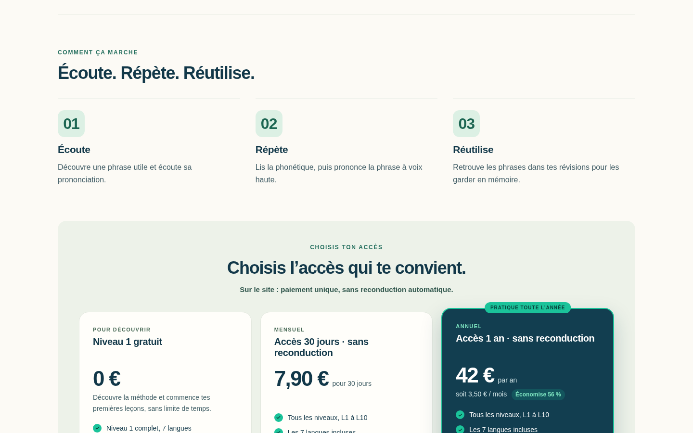

# Chiffres de la méthode et intitulé Google

Correctif demandé par Kartech et publié le 21 octobre 2026 sur `main`, commit `e9ab12d14330e562c734adb1747463cfbfc3acf9`.

Les chiffres 01, 02 et 03 passent de 14 à 32 pixels dans des repères de 56 × 56 pixels, au lieu de 34 × 34. Le rendu est vérifié à 1440 et 1024 pixels de large, sans débordement ni chevauchement. L'accueil mobile et son accès à la méthode restent fonctionnels.

Le titre « Maquette bleu nuit » figurant dans la capture Google n'est déjà plus dans les titres HTML actuellement publiés. Les URL `/`, `/index.html` et la variante `www` servent bien « Melunga — Des phrases utiles pour oser parler » ; `www` redirige vers le domaine principal.

Ce titre et la description sont conservés. Le correctif ajoute une URL canonique, des métadonnées sociales cohérentes, le favicon existant, une déclaration WebSite du nom Melunga, un sitemap limité à l'accueil et sa référence dans `robots.txt`. Aucun blocage d'indexation ni changement des cours n'est ajouté.

Les quatre fichiers publiés répondent en HTTPS avec le statut 200 et sont identiques aux fichiers vérifiés localement : `index.html`, `desktop-home.css`, `robots.txt`, `sitemap.xml`. Voir `verification-production.json`. Le contrôle local de la structure HTML, du JSON-LD et du XML figure dans `verification-locale.json`.

Google peut conserver son ancien résultat jusqu'à une nouvelle exploration, ou réécrire le titre. Aucun délai de réindexation n'est garanti et aucune demande Search Console n'est présentée comme effectuée.

L'APK d'essai v4 reste celui du commit `94f1c4f`. Les grands chiffres concernent la présentation ordinateur, masquée dans le conteneur natif ; les métadonnées de recherche concernent le site public. Aucun nouvel APK n'est nécessaire pour ce correctif web.

