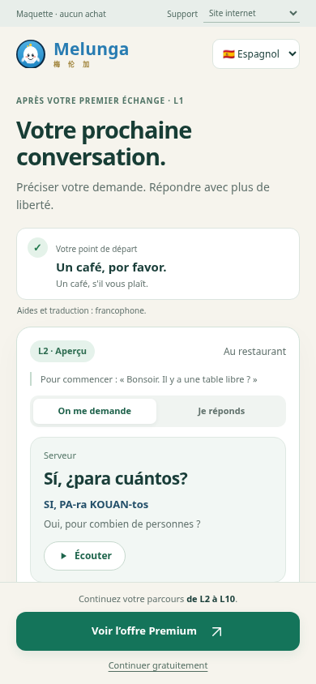

# Ma prochaine conversation — maquette d'incitation à Premium

Proposition pour Kartech et Claude. Ce prototype se trouve dans les documents de revue, hors du dossier publié par Netlify. Il n'est inclus dans aucun écran de production et ne modifie aucun contenu, prix, abonnement ou droit. Le travail APK reste reporté.

## Geste proposé

Après une première expérience L1, montrer le point de départ concret, puis une nouvelle situation L2. La personne écoute ce qu'on lui dit et découvre une réponse préparée, avec phonétique et sens. Elle peut consulter Premium ou revenir à un échange gratuit.

L'incitation tient à la suite visible de son apprentissage. Il n'y a ni compte à rebours, offre inventée, certificat de maîtrise ni obligation de terminer le catalogue pour voir L2. Les offres existantes restent la référence et aucune conversion n'est prédite.

## Utilisation locale

Depuis ce dossier :

```sh
python3 -m http.server 8918 --bind 127.0.0.1
```

Ouvrir localement `index.html`. Les paramètres de revue `?pair=fr-es&surface=web` et `?pair=fr-zh&surface=native` choisissent le couple et le support simulé. Les commandes sont aussi disponibles en haut. L'interface de revue est en français pour Kartech ; les exemples gardent la traduction et la phonétique de leur lecteur source.

Cette adresse locale sert aux contrôles internes, pas de lien de présentation à partager dans le chat. Les captures et les sources peuvent être lues dans la branche GitHub de revue.

## Provenance et limites

- `data.js` reprend sept couples actifs, leurs échanges L1 et des extraits L2, sans modification des phrases complètes ni de leurs aides. `source-data.json` enregistre les références et empreintes des quatorze fichiers d'origine.
- La phrase L1 est le tour 2 du premier dialogue. L'aperçu L2 joue les tours 1 et 2 ; le sens natif du tour 0 donne le contexte. L'échange L1 complet reste consultable dans le retour gratuit.
- Les soixante-dix correspondances de tours — dix par couple, avec le contexte — ont été vérifiées. Certaines répliques L2 ont plusieurs intentions : elles sont conservées entières, à relire pour le choix final de l'aperçu. Aucun effet de simplicité ou d'efficacité n'est prétendu sur cette seule extraction.
- L'audio local utilise la synthèse vocale du navigateur et le texte étudié complet. Il ne constitue pas une validation des voix ni des sons/tons de l'audio de production. La disponibilité dépend du navigateur.
- Les montants illustrés sont ceux du marché France, issus de `pricing-table.mjs` : 7,90 € / 30 jours et 42 € / 365 jours. L'offre web est présentée comme un paiement unique sans reconduction. Le mode Android ne fabrique ni prix boutique ni éligibilité à un essai ; le store n'est pas ouvert.
- Le retour gratuit représente le maintien des droits pour cet essai. Le catalogue complet n'est pas reproduit dans le prototype. Le choix d'une réduction réelle de l'offre reste séparé et non réalisé.
- Les clics restent dans `window.demoEvents`, en mémoire. Aucun appel de paiement ou d'analytique, aucune écriture de droits en stockage et aucune affectation de `isPaid` n'ont lieu. La confirmation de choix affichée est explicitement un essai, jamais un achat réussi.
- Le contexte « après un échange L1 » est simulé pour montrer l'emplacement proposé. Un futur déclencheur devra être défini sans confondre fin d'un écran et maîtrise de la conversation.

## Relecture avant intégration

Kartech choisit le mécanisme et la présentation. Claude relit la cohérence de l'extrait, ses aides et sa difficulté ; les libellés destinés aux lecteurs sont à préparer. Définir ensuite un lot d'intégration relié aux offres réelles, vérifier les droits sur chaque support et planifier les essais APK. Cette maquette ne vaut pas autorisation de fusion ou de publication.

## Vérification du 21 octobre 2026

Commande : `node docs/revue-pedagogique/maquette-premium/verify.cjs` depuis la racine du dépôt, avec Chromium et `playwright-core` disponibles. Le serveur de contrôle est local et arrêté à la fin du script. Les captures vont par défaut dans `/tmp/melunga-premium-review` ; définir `MELUNGA_PREMIUM_CAPTURES` pour changer ce dossier.

Résultat : **PASS** pour sept couples à 390 × 844, 320 × 568 et 1440 × 900. Les soixante-dix références de tours correspondent aux sources, y compris les lectures zh/ja/ko lorsqu'elles sont fournies. Les deux répliques, leurs aides et le texte complet transmis à la synthèse ont été contrôlés.

L'offre web conserve ses périodes et ses prix ; le mode Android n'invente pas ceux de Google Play. Les retours gratuits, Échap et la restitution du focus fonctionnent. Aucun débordement horizontal, erreur JavaScript, appel d'achat ni écriture de droits n'a été relevé. Sur mobile, le dialogue d'offre couvre tout l'écran, avec un fond opaque.

L'audio a été simulé pour vérifier le texte transmis : la qualité sonore réelle et l'intégration native ne sont pas certifiées. Le mode Android de cette maquette est une présentation dans le navigateur, pas un essai APK.

Captures du véritable viewport, sans sélection d'offre :

- [Aperçu sur téléphone](captures/phone-module.png) · [Offre web sur téléphone](captures/phone-offer.png)
- [Aperçu sur ordinateur](captures/desktop-module.png) · [Offre web sur ordinateur](captures/desktop-offer.png)


