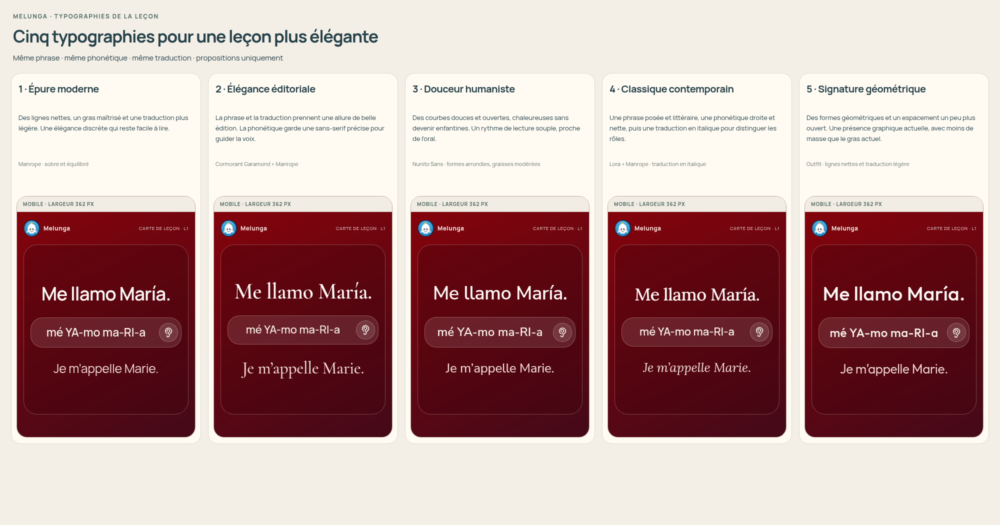
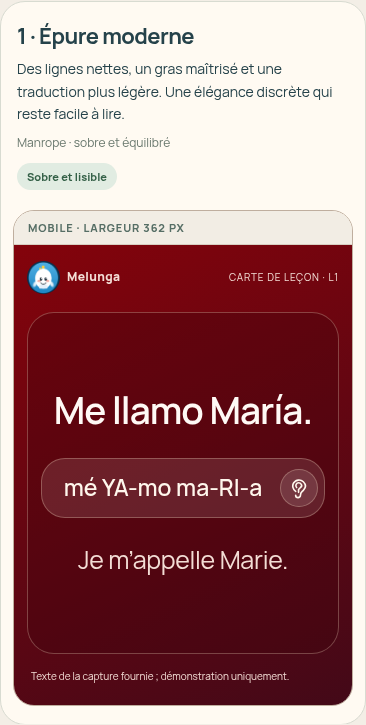
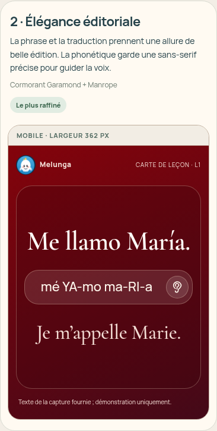
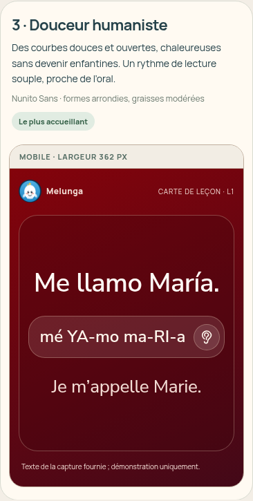
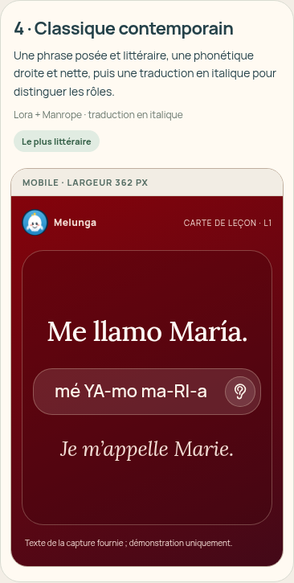
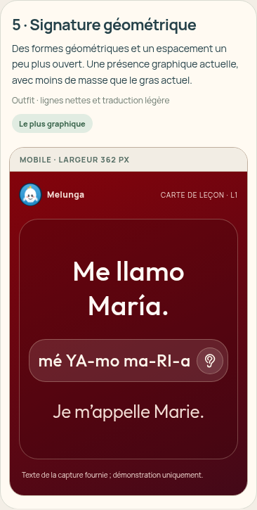
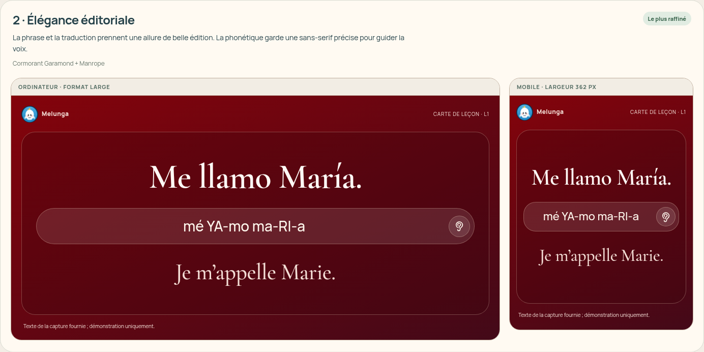
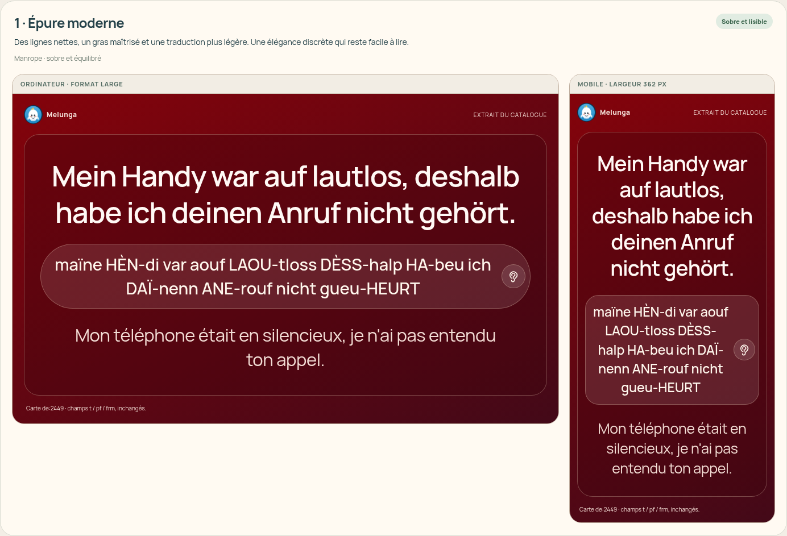
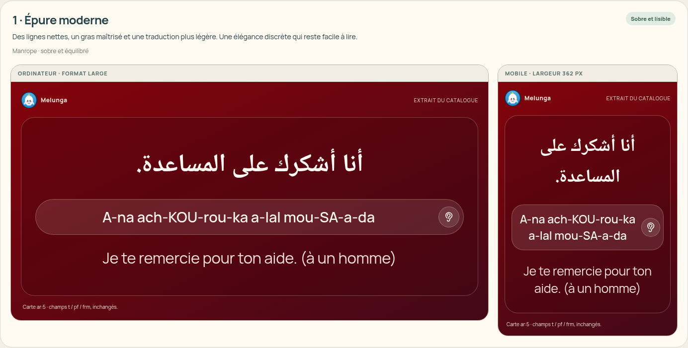

# Cinq typographies pour la leçon — propositions seulement

Les cinq variantes reprennent la phrase, la phonétique et la traduction de la capture de Kartech : « Me llamo María. », « mé YA-mo ma-RI-a », « Je m’appelle Marie. ». C’est un exemple de présentation fourni par l’utilisateur, pas une nouvelle carte ajoutée à la banque.

| Nº | Proposition | Polices | Caractère |
|---|---|---|---|
| 1 | Épure moderne | Manrope | Sobre, nette, gras modéré ; traduction plus légère. |
| 2 | Élégance éditoriale | Cormorant Garamond + Manrope | Le plus raffiné ; phrase et traduction avec empattements, phonétique droite et précise. |
| 3 | Douceur humaniste | Nunito Sans | Courbes ouvertes, chaleureuses, sans gras excessif. |
| 4 | Classique contemporain | Lora + Manrope | Phrase littéraire ; traduction seule en italique. |
| 5 | Signature géométrique | Outfit | Formes géométriques, espacement plus ouvert, présence graphique. |

Pour rester très sobre : **1**. Pour un effet plus élégant et éditorial : **2**. Les majuscules, accents et tirets phonétiques sont conservés et restent opaques ; aucune police cursive ni italique ne touche la phonétique.

## Page indépendante

[Page HTML des propositions](../../melunga_deploy/propositions-typographie-lecon.html), accompagnée de ses [polices et licences locales](../../melunga_deploy/assets/typographie-propositions/manifest.json). Une fois déployée, adresse `/propositions-typographie-lecon.html`. Le déploiement public n’est pas vérifié depuis cet environnement ; les images jointes permettent de voir les propositions directement sans ouvrir du code.

Les contrôles permettent de comparer mobile/ordinateur, trois fonds et douze exemples : phrase de la capture, phrase allemande longue et autres écritures. L’allumage de la capsule est une simulation visuelle, sans son. Sur petit écran, le format mobile est montré par défaut.

**Aucune intégration dans l’application.** Ni les pages d’entrée/leçon, ni les polices de production, ni les données de cartes, comptes, paiement, progression, thèmes ou événements audio ne sont modifiés. Les six fontes originales représentent 2,475,812 octets, uniquement chargées par la page de propositions. **Zéro octet ajouté à app.html** et aucun chargement supplémentaire dans la leçon actuelle. Les fichiers de fonte ne sont pas modifiés ; les cinq licences SIL Open Font License 1.1 et les empreintes sont conservées.

Les écritures chinoise, japonaise, coréenne, arabe et devanagari utilisent des polices adaptées à leur langue, avec repli système. Ces fontes ne sont pas embarquées dans la proposition : leur apparence dépend de l’appareil. Le choix final devra être vérifié pour les 13 langues, toutes les ambiances et les appareils réels avant intégration.

## Vérifications

Chromium, largeurs 390 et 1440 px, **72 cas exemple/fond/largeur**, chacun vérifiant les cinq variantes dans les deux formats. Les six fontes demandées sont chargées, les textes/accents/majuscules sont conservés, les phrases longues et les autres écritures se replient sans débordement horizontal, et la phonétique reste droite et opaque. Les contrôles de format et d’aperçu lumineux fonctionnent sans déplacement de la capsule. Aucun appel à un service externe n’est effectué par la page ; les fontes sont servies localement. Les cinq contrôles de source passent ; les pages et styles de production sont comparés octet par octet à la base `c5f58f4` et restent identiques. Aucun appareil physique testé.

## 1 — Épure moderne

## 2 — Élégance éditoriale

## 3 — Douceur humaniste

## 4 — Classique contemporain

## 5 — Signature géométrique

## Ordinateur et autres écritures

