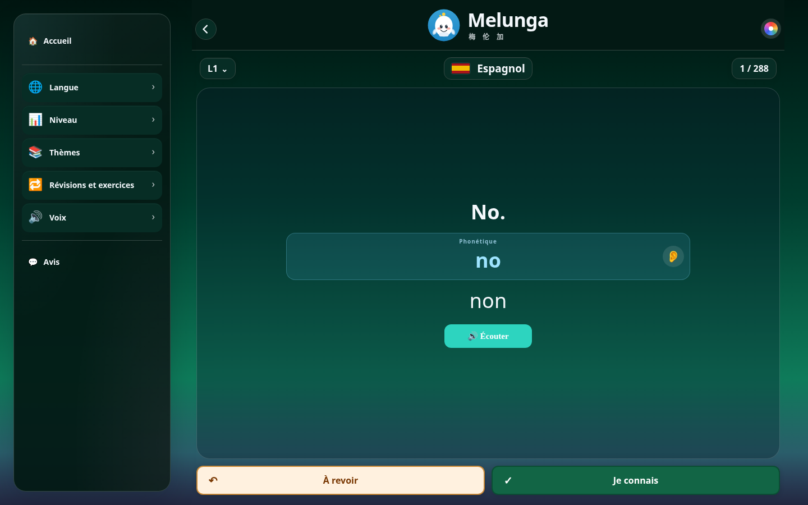
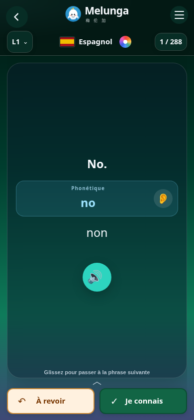
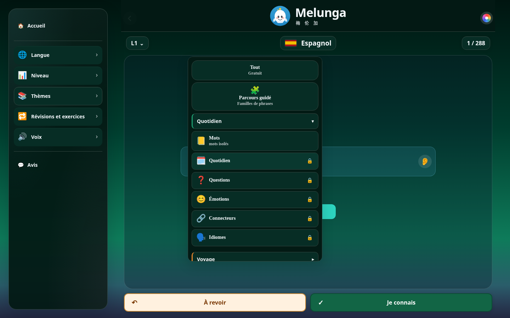

# Aperçu des leçons : menu et indicateurs teintés

Essai sur `ui/lesson-glass-chrome`, basé sur `main` au commit `25a7cad`. Cette direction visuelle reste à valider avant publication.

## Proposition

- Remplacer le grand panneau blanc par une surface teintée qui reprend l'ambiance choisie, avec de légers reflets cyan et rose.
- Assortir le niveau et le compteur à cette surface, avec des chiffres nets et des bordures fines.
- Donner aussi au logo et au nom de langue sur ordinateur un fond teinté : certains dégradés sont trop lumineux pour un texte blanc sans support.
- Garder l'en-tête compact sur téléphone, le drapeau au centre et la palette près de la langue.
- Limiter les anciens menus Thèmes, Voix et Révisions à 380 px, avec un défilement intérieur. Les groupes de thèmes existants deviennent une liste verticale lisible.

La carte de phrase, la phonétique, l'oreille et les boutons de notation ne sont pas restylés par cet essai. Aucun catalogue, prix, niveau gratuit ou droit d'accès ne change.

## Réalisation

`melunga_deploy/lesson-chrome.css` ajoute une couche de présentation après les feuilles existantes. Les couleurs viennent de `--bg`, `--card`, `--ink` et `--accent`. Les anciennes couleurs imposées en JavaScript dans `app.html` utilisent maintenant les variables du menu ; le changement d'ambiance s'applique donc sans reconstruire les éléments.

Aucun filtre ni transformation n'est ajouté au tiroir : les sous-menus en position fixe continuent de se référer à la fenêtre. L'effet de matière repose sur les teintes, les reflets et les bordures. Des replis sont prévus sans `color-mix()`, ainsi que pour les préférences de mouvement et de transparence réduits.

Sur le web mobile, la disposition reste compacte. Les styles partagés peuvent être repris dans un prochain assemblage Capacitor ; aucun APK ni AAB n'est produit par cet essai et aucune installation Android n'est revendiquée.

## Contrôles

La suite existante des sélecteurs est passée avec cette couche visuelle : langues, niveaux L1–L10, commandes clavier, focus, gestes tactiles, clic extérieur et accès Premium.

Les captures et le rapport joints proviennent de la vraie page servie localement avec les API simulées, sans appel de paiement ni audio distant. Ils servent à examiner l'aperçu, et ne prouvent pas une mise en production.

Contrôles complémentaires : menus aux formats 320×568, 390×844 et 1440×900 ; ambiances Aurore, claire et rose ; contraste du nouvel en-tête et des indicateurs sur 14 ambiances ; retour à la carte précédente ; compteurs réels 288 / 288 et 142 / 142 sur une ligne à 320 px. Contrôles locaux réussis, sans essai sur téléphone physique.

