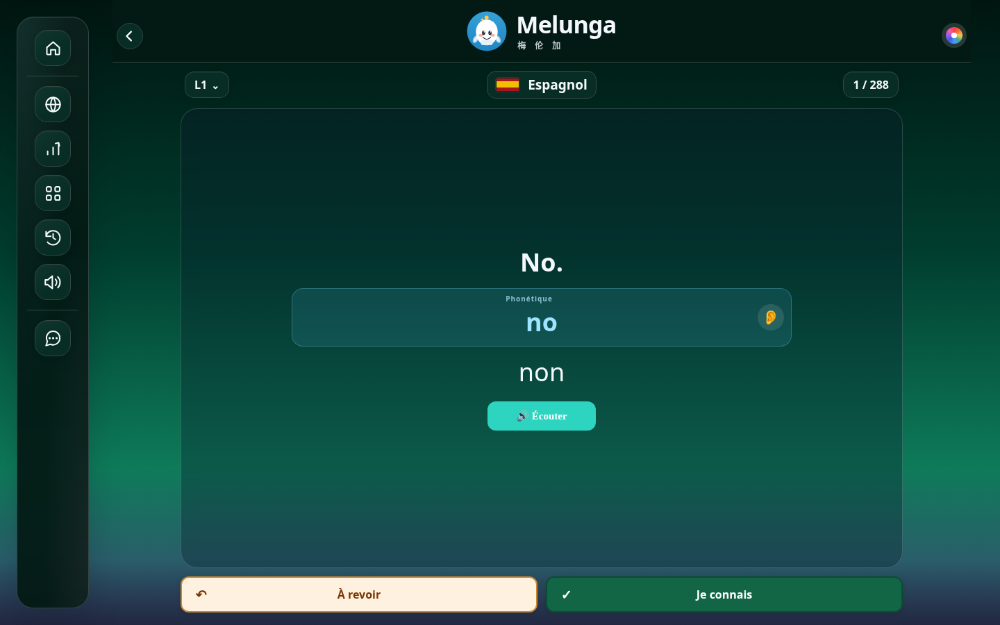
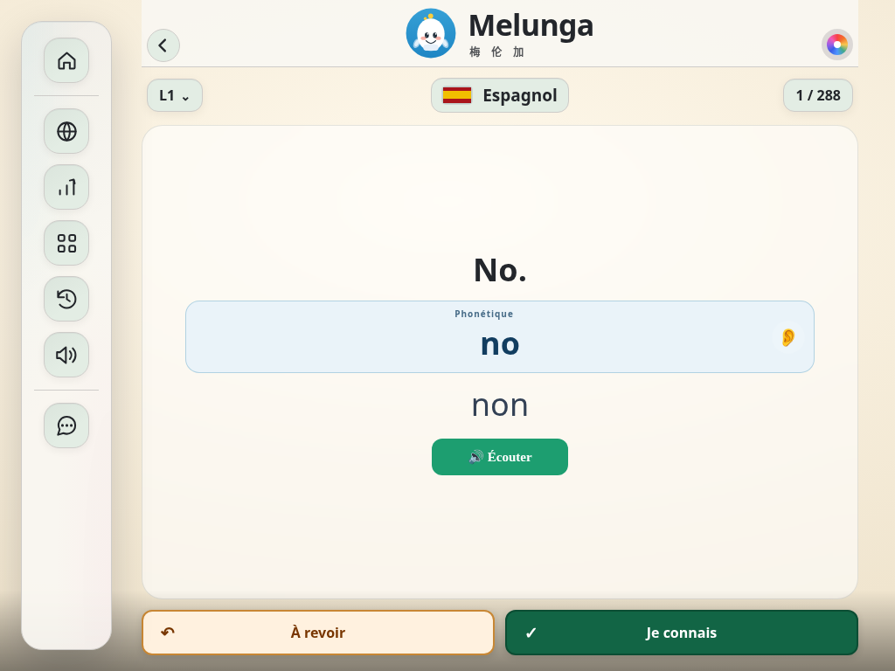
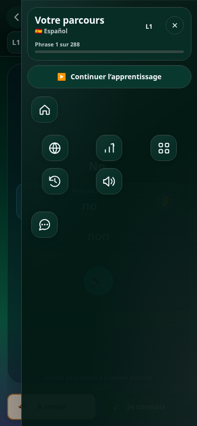

# Navigation par icônes — nouvel aperçu

À la demande de Kartech : supprimer les émojis scolaires et les libellés permanents du menu. Cette version reste sur la branche d’essai, sans modification du site en production.

- Icônes SVG sobres : accueil, langue, niveau, thèmes, révisions, audio et avis.
- Rail étroit sur ordinateur ; vignettes dans le tiroir sur mobile.
- Noms disponibles au survol et au clavier, avec traduction dans les sept langues du lecteur. La langue, le niveau et la voix courants sont conservés dans les noms accessibles.
- Thème choisi, drapeau de la leçon, palette, phonétique et oreille conservés.

Les contrôles réutilisent les éléments et les actions existants. `lesson-controls.js` ajoute les icônes et les noms ; `lesson-controls.css` adapte le rail et les vignettes. Le script est partagé avec le rendu Capacitor, sans dépendre de l’adaptation desktop. Aucun catalogue, prix ni droit d’accès n’est modifié.

## Vérifications locales

PASS : quatre formats (1440×900, 1024×768, 390×844 et 320×568), vingt ouvertures de menus au clavier, sept langues du lecteur, changements de langue et de thème, redimensionnement et absence de doublons. Infobulles au survol et au focus, fermeture par Échap et retour du focus vérifiés séparément. La déconnexion masquée reste masquée. Aucune erreur JavaScript.

La simulation Capacitor conserve les dimensions, la typographie et les couleurs de la leçon. Aucun APK n’est construit et aucun essai sur appareil réel n’est revendiqué.

