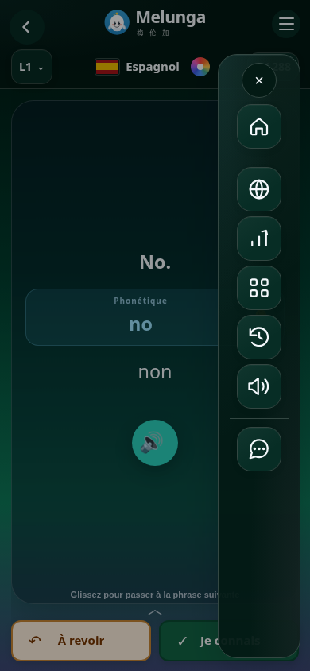
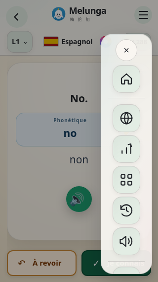

# Menu mobile en colonne

Essai demandé après validation visuelle du rail ordinateur : remplacer la grille mobile par la même colonne d’icônes, disponible à l’ouverture du menu. Cette version n’est pas déployée en production.

- Volet de 104 px à droite, visible après appui sur le menu ; fermé hors écran et non interactif.
- Même ordre et mêmes pictogrammes que sur ordinateur ; vignettes de 56 px et SVG de 30 px.
- Défilement vertical intérieur, croix de fermeture accessible et leçon visible derrière. Le panneau « Votre parcours » et le bouton « Continuer » ne sont plus répétés dans le menu.
- Gestes tactiles isolés du suivi des cartes : faire défiler le rail ne note pas et ne fait pas avancer la leçon.
- Présentation ordinateur conservée.

## Contrôles

PASS aux formats 390×844 et 320×568, en ambiances Aurore et claire. Sept actions atteignables, vingt ouvertures de sous-menus réussies, aucun piège pour les panneaux fixes, gestes réels sans modification de carte, de pool ou de notes. Le retour du focus sur Accueil tient compte de la croix fixe grâce à la marge de défilement. Fermeture vérifiée après défilement, sans focus conservé sur un élément caché.

La comparaison avec la version précédente confirme que la géométrie, la typographie et les couleurs du rendu ordinateur sont identiques. Le rail est aussi vérifié en simulation Capacitor, sans installation Android ni construction APK.

